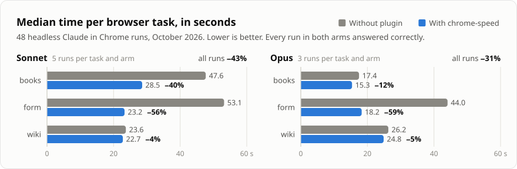

# claude-chrome-speed

A Claude Code plugin that cuts the time [Claude in Chrome](https://claude.com/chrome) takes to do browser tasks.

On six browser tasks, runs with the plugin took on average **40% less time on Sonnet 5.5** and
**28% less on Opus 5.5**, with every answer correct in both arms (240 runs). Both averages come
from a [pre-registered](bench/ANALYSIS_PLAN.md) test (p = 0.0001 for each model). Per-task
results, including the ones that aren't significant, are in [Results](#results).

<picture>
  <source media="(prefers-color-scheme: dark)" srcset="docs/results-dark.svg">
  
</picture>

## Install

In Claude Code:

```
/plugin marketplace add cr1707/claude-chrome-speed
/plugin install chrome-speed@claude-chrome-speed
```

Or paste [`rules/chrome-speed.md`](rules/chrome-speed.md) into `~/.claude/CLAUDE.md`.
Those are the same rules without the plugin, but only the plugin route was measured.

## What it does

At the start of each session it adds a short set of rules to Claude's context: batch
browser steps, read pages as text instead of screenshots, pull paginated data with one
script, and click in a way that doesn't silently miss. That's about 750 input tokens,
cached after the first request. Nothing else to configure. The full list is in
[What the rules change](#what-the-rules-change).

## Results

> The benchmark measured the rules as tagged [`v0.1.0`](https://github.com/cr1707/claude-chrome-speed/tree/v0.1.0).
> v0.2.0 changes one rule: the 0.1-scale screenshot is retaken after every page load, from a
> finding confirmed after the benchmark. That change wasn't benchmarked separately.

240 headless runs on one Mac on 10 October 2026: 6 tasks, without and with the plugin,
10 runs per task and arm on each of two models, `claude-sonnet-5-5` and `claude-opus-5-5`.
The tasks are described in [How the benchmark works](#how-the-benchmark-works).

**Average over the six tasks** (the pre-registered headline test):

- **Sonnet 5.5:** runs with the plugin took 40% less time (p = 0.0001; 95% CI 34% to 44%).
- **Opus 5.5:** 28% less time (p = 0.0001; 95% CI 23% to 33%).

This is the average over these six tasks on one machine. Other sites and tasks may differ.

**Per task.** Median seconds per run, without → with the plugin:

**Sonnet 5.5**

| Task | Median time | Change | 95% CI | Significant after Holm | Correct |
|---|---|---|---|---|---|
| `books` | 27.5 s → 15.4 s | −44% | −51% to −32% | yes (p = 0.0001) | 10/10 → 10/10 |
| `form` | 44.5 s → 18.4 s | −59% | −62% to −56% | yes (p = 0.0001) | 10/10 → 10/10 |
| `wiki` | 28.5 s → 21.2 s | −25% | −31% to −20% | yes (p = 0.0002) | 10/10 → 10/10 |
| `spa` | 49.6 s → 23.7 s | −52% | −61% to −48% | yes (p = 0.0002) | 10/10 → 10/10 |
| `catalog` | 24.8 s → 21.1 s | −15% | −19% to −10% | yes (p = 0.0002) | 10/10 → 10/10 |
| `suppliers` | 26.7 s → 20.6 s | −23% | −33% to −11% | yes (p = 0.0007) | 10/10 → 10/10 |

**Opus 5.5**

| Task | Median time | Change | 95% CI | Significant after Holm | Correct |
|---|---|---|---|---|---|
| `books` | 17.4 s → 15.4 s | −11% | −15% to 0% | no (p = 0.30) | 10/10 → 10/10 |
| `form` | 43.7 s → 20.4 s | −53% | −66% to −31% | yes (p = 0.0004) | 10/10 → 10/10 |
| `wiki` | 26.1 s → 21.6 s | −17% | −36% to 0% | no (p = 0.13) | 10/10 → 10/10 |
| `spa` | 58.5 s → 26.2 s | −55% | −62% to −50% | yes (p = 0.0001) | 10/10 → 10/10 |
| `catalog` | 30.2 s → 24.1 s | −20% | −42% to −1% | no (p = 0.13) | 10/10 → 10/10 |
| `suppliers` | 23.7 s → 20.7 s | −13% | −24% to +16% | no (p = 0.30) | 10/10 → 10/10 |

"Change" is the change in median time. "Significant after Holm" is the pre-registered
two-sided permutation test, corrected for the 12 per-task tests; the p-values shown are the
corrected ones. The 95% CIs are bootstrap intervals and are not corrected, so a CI that
excludes zero doesn't by itself mean "significant".

What this shows:

- **The two form tasks, `form` and `spa`, gain the most on both models**: about half the
  time or less (−52% to −59%), with median turns dropping from 10–21 to 6–7. That's where the
  click and `read_page` quirks below cost the most turns.
- **On Sonnet 5.5, every task took less time with the plugin**, and each one is significant
  on its own after correction.
- **On Opus 5.5, the four extraction and lookup tasks moved less** (−11% to −20%), and none
  of them is significant on its own after correction. Without the plugin, Opus already did
  `books`, `wiki` and `suppliers` in fewer turns than Sonnet 5.5 (median 6–8.5 against
  12–14), so there was less to cut. With 10 runs per arm, this run can't tell how much the
  plugin helps on these four. The data fit anything from:
  - `books`: a 15% saving to no change;
  - `wiki`: a 36% saving to no change;
  - `catalog`: a 42% saving to a 1% saving;
  - `suppliers`: a 24% saving to a 16% slowdown.

  For `wiki` and `catalog` the uncorrected p-value is below 0.05: a suggestive difference
  that doesn't survive the correction for 12 tests.
- **Correct answers: 10/10 without and 10/10 with the plugin in every cell** (240 of 240).
  Ten runs per cell can't rule out a small failure rate in either arm.
- The two models weren't compared with each other statistically. A task being significant on
  one model and not the other doesn't show that the plugin helps one model more.

**Checks.** The sensitivity analyses in the plan and its amendments point the same way:

- Repetitions 6–10 only (collected after the plan was written): 35% less time on Sonnet 5.5,
  28% on Opus 5.5.
- Without the one run that had an API stall over 60 s (an 87 s stall in a Sonnet 5.5
  `catalog` run without the plugin): 36% and 28%.
- Putting the excluded runs that finished back in (intention-to-treat): 40% and 29%.
- A rank-based test per task gives the same significant / not significant verdict for every
  task. So do the independent reviewer's exact rank test and paired analysis.

Full output: [`bench/results/FINAL_ANALYSIS.md`](bench/results/FINAL_ANALYSIS.md) (the
pre-registered analysis) and [`bench/results/VERIFICATION.md`](bench/results/VERIFICATION.md)
(the independent re-analysis, which agrees). The 95% CIs on the two averages come from the
verification. They weren't part of the plan.

An earlier pilot on Sonnet 5 (30 runs, `books`, `form` and `wiki` only) is in
[`bench/results/sonnet-5/RESULTS.md`](bench/results/sonnet-5/RESULTS.md). It's not part of
the final tests (see [Disclosures and limits](#disclosures-and-limits)).

## Stop the permission prompts too

The benchmark runs pre-approved, so it doesn't count the time you spend clicking "Allow".
In daily use that's often the biggest delay. Add the Chrome tools to your
`~/.claude/settings.json`, plus the sites you trust:

```json
{
  "permissions": {
    "allow": [
      "mcp__claude-in-chrome",
      "ClaudeInChromeDomain(example.com)"
    ]
  }
}
```

`mcp__claude-in-chrome` approves the browser tools. Each site still needs its own
`ClaudeInChromeDomain(...)` entry, so Claude can't wander onto new domains without asking.
A copy is in [`settings/permissions.example.json`](settings/permissions.example.json).

## Three things worth knowing about the browser tools

Found while building the benchmark (Claude Code 2.1.281–2.1.296, Claude in Chrome 1.0.100,
Chrome 154, macOS, October 2026). Each one cost extra turns in the test runs.

1. **A click is silently dropped until the tab has had a screenshot since its page loaded.**
   Claude's tabs open in the background, where the page reports `visibilityState: "hidden"`.
   In that state `left_click` reports "Clicked on element", but no event reaches the page.
   Any screenshot of the tab, even at `scale: 0.1`, makes the next clicks land on the
   element's exact centre. The effect resets every time the tab loads a new page or reloads
   (a same-page `#anchor` jump doesn't reset it), so the screenshot is needed again after each
   navigation. `document.hasFocus()` is not a reliable signal for this. Dropped clicks never
   hit a different element or tab (tested on a grid of buttons). Since v0.2.0 the rules take
   that 0.1-scale screenshot before the first click after every page load.
   Repro page: [`bench/fixtures/click-probe.html`](bench/fixtures/click-probe.html).
   Reported to Anthropic: [anthropics/claude-code#101001](https://github.com/anthropics/claude-code/issues/101001)
   (the page-load reset is in the [follow-up comment](https://github.com/anthropics/claude-code/issues/101001#issuecomment-6096699995)).
2. **`read_page` with `filter: "interactive"` only returns what's on screen.** Form fields
   and buttons below the fold are left out, so Claude has to scan the page again. Without
   the filter, everything is included.
3. **Clicking a link and reading the page in the same batch can read the old page.** The
   read runs before the next page has loaded. Getting the link's URL and calling `navigate`
   waits for the page to load.

## What the rules change

| Default habit | Rule |
|---|---|
| `tabs_context` → `tabs_create` → `navigate` | `navigate` with no tab ID (it creates the tab itself) |
| Screenshot to read a page | `get_page_text`, or a script that returns JSON |
| Visit page 1, page 2, page 3… | One `javascript_tool` call that fetches and parses all pages |
| One call per form field | One full `read_page`, then every field, the submit and the read in one `browser_batch` |
| Click a link, then read | Get its URL, `navigate`, then read |
| Full-size screenshots | `scale: 0.5`, or `0.1` just to prime clicks after each page load |

They change how Claude works, not what it's allowed to do. Permission checks and
confirmations still apply.

## Why a hook and not a skill

The first draft was a skill. Loading a skill is a tool call of its own, which costs a turn.
In a pilot with one run per task and arm, Claude loaded the skill every time. On the
Wikipedia task both arms made the same number of browser calls, and the skill arm took 6 s
longer (31.9 s against 26.0 s). That's one run per arm, so it's a hint rather than a
measurement. Injecting the rules at session start removes the extra turn. The draft's runs
are kept in [`bench/results/skill-draft/`](bench/results/skill-draft/).

## How the benchmark works

[`bench/run.py`](bench/run.py) runs each task as a fresh headless session
(`claude -p --chrome`), once without the plugin and once with `--plugin-dir`, and
alternates which goes first on each repetition. Runs work in an empty temporary folder
outside the repo, so no `CLAUDE.md`, memory or other MCP servers reach either arm. Answers are
checked against known values, so a fast wrong answer doesn't count as a win.

| Task | What it does | Checked against |
|---|---|---|
| `books` | Finds the 3 most expensive books in a 2-page category on [books.toscrape.com](https://books.toscrape.com) | Titles and prices |
| `form` | Fills and submits a 10-field form ([local page](bench/fixtures/form.html)) | Confirmation code, which is a hash of every field |
| `wiki` | 2018 World Cup winner → its capital → population in the Wikipedia infobox | City and number |
| `spa` | Creates an account in an app-style form with controlled inputs, a custom dropdown and a toggle ([local page](bench/fixtures/spa-form.html)) | Confirmation code, which is a hash of every field |
| `catalog` | Finds the 3 cheapest well-rated lighting products in a 120-item list that loads 20 at a time ([local page](bench/fixtures/catalog.html)) | Names and prices |
| `suppliers` | Compares three quotes with shipping, discounts and fees ([a](bench/fixtures/supplier-a.html), [b](bench/fixtures/supplier-b.html), [c](bench/fixtures/supplier-c.html)) | Cheapest supplier and its total |

**Analysis.** The analysis was written down before the final data was collected, in
[`bench/ANALYSIS_PLAN.md`](bench/ANALYSIS_PLAN.md) (pre-registered in commit
[`640d42f`](https://github.com/cr1707/claude-chrome-speed/commit/640d42f)).
Three amendments were added during collection, before the final analysis: a rule for
infrastructure failures, pinned model ids with sensitivity analyses, and independent checks.
[`bench/analyze.py`](bench/analyze.py) implements the plan and was run once on the complete
data. Its output is [`bench/results/FINAL_ANALYSIS.md`](bench/results/FINAL_ANALYSIS.md).
An independent reviewer's script, [`bench/verify_stats.py`](bench/verify_stats.py),
re-derives every number with different code and adds exact rank tests, Hodges–Lehmann
estimates and a paired analysis. Its output is
[`bench/results/VERIFICATION.md`](bench/results/VERIFICATION.md).

The headline average is each task's relative saving in mean time, averaged over the six
tasks, with a one-sided permutation test that shuffles the arm labels within each task. With
10,000 permutations, 0.0001 is the smallest p-value it can give. The 12 per-task tests are
Holm-corrected as one family; the two averages are a separate family.

**Run it yourself:**

```bash
(cd bench/fixtures && python3 -m http.server 8799 --bind 127.0.0.1 &)
python3 bench/run.py --model claude-sonnet-5-5 --reps 10 --out bench/results/mine-sonnet/runs.jsonl
python3 bench/run.py --model claude-opus-5-5 --reps 10 --out bench/results/mine-opus/runs.jsonl
python3 bench/summarize.py bench/results/mine-sonnet/runs.jsonl
python3 bench/verify_stats.py --sonnet bench/results/mine-sonnet/runs.jsonl \
                              --opus bench/results/mine-opus/runs.jsonl
```

- Always write to a new file with `--out`, never to one of the committed `runs.jsonl` files.
- Pass the full model id. The `sonnet` alias moved from `claude-sonnet-5` to
  `claude-sonnet-5-5` partway through this study, when Claude Code updated.
- `python3 bench/exclude.py <results folder>` lists runs where the browser wasn't connected.
  Add `--apply` to exclude them, then re-run each one once with `--tasks`, `--conds`,
  `--start-rep` and `--reps 1`.
- `verify_stats.py` runs the same primary tests on your files. `analyze.py` always reads the
  committed `sonnet-5-5` and `opus` folders.

To re-check the published numbers, run `python3 bench/analyze.py` and
`python3 bench/verify_stats.py` with no arguments. On a fresh clone, `analyze.py` reproduces
`FINAL_ANALYSIS.md` exactly up to the API-stall check, then stops, because that check and the
denied-call count need the raw logs. `verify_stats.py` reproduces the main numbers but skips
the checks that need the raw logs.

It needs Claude Code with the Claude in Chrome extension connected. The runs open tabs in
your browser, and each run counts against your plan like any other session.
[`bench/settings.json`](bench/settings.json) pre-approves only the browser tools and the
three test sites. Each run's full log is written to a `raw/` folder next to its `runs.jsonl`.
Those logs aren't committed, because they hold copied page text and local paths.
`python3 bench/run.py --regrade --out <runs.jsonl>` re-scores saved runs from them.
`python3 bench/chart.py` redraws the chart at the top from the committed results and
`FINAL_ANALYSIS.md`.

## Disclosures and limits

- **One machine, one day.** One Mac (macOS, Chrome 154, Claude in Chrome 1.0.100), one
  Chrome profile, one network and one account, all on 10 October 2026. `books` and `wiki` use
  live sites, which add network noise. Expect the exact percentages to move with model,
  extension version and site.
- **Claude Code versions.** Every run used Claude Code 2.1.296, except Opus `books`, `form`
  and `wiki` repetitions 1–3 (both arms), which ran on 2.1.281. The Opus rows from
  repetitions 1–5 don't store the model id in `runs.jsonl`; their raw logs show
  `claude-opus-5-5` ([`VERIFICATION.md`](bench/results/VERIFICATION.md), section C).
- **Sonnet 5 pilot dropped.** Updating Claude Code during the study moved the `sonnet` alias
  from `claude-sonnet-5` to `claude-sonnet-5-5`. The first Sonnet runs (30 runs on `books`,
  `form` and `wiki`) were on `claude-sonnet-5`, so all Sonnet 5.5 runs were collected again
  with the full model id. The Sonnet 5 runs are kept as a pilot in
  [`bench/results/sonnet-5/`](bench/results/sonnet-5/RESULTS.md), outside the final tests.
- **Three runs excluded and re-run.** Under the rule in amendment 1, three runs where the
  browser extension wasn't connected were excluded and re-run once each:
  - Sonnet 5.5 `suppliers` repetition 5: one without the plugin, one with;
  - Opus 5.5 `spa` repetition 1: without the plugin.

  Each results folder lists its exclusions in `excluded.jsonl`. Putting back the ones that
  finished changes the averages to 40% and 29%.
- **Order alternated, not randomised.** The two arms of a task run back to back, and which
  goes first alternates on each repetition. The measured order effect was +2% for the second
  run of a pair on both models, not significant.
- **The author wrote the tasks.** The three newer tasks (`spa`, `catalog`, `suppliers`) were
  written by the plugin's author after the rules. Two of them involve situations the rules
  address: fields that only register real input events, and paginated data. The rules weren't
  changed for them. The first three tasks are where the rules were developed.
- **Background load.** Between about 11:00 and 11:25 CEST, a reviewer ran CPU-heavy statistics
  simulations on the same Mac, at background priority, while runs were being collected. The
  arms ran back to back, so any slowdown should have hit both about equally.
- **Denied tool calls.** The test harness allows only the browser tools. Other calls, mostly
  Bash (`curl` to fetch the test pages directly) and a few WebFetch, were refused: Sonnet 5.5
  86 without the plugin and 30 with it; Opus 5.5 29 and 21. Each refusal costs a turn. In
  real use these would be permission prompts (or allowed), so this adds turns mostly to the
  runs without the plugin.
- **Amendments during collection.** The plan was amended three times while runs were being
  collected, before the final analysis, and some run times had been seen by then. Each
  amendment and its reason is in the plan.
- **Haiku couldn't be tested.** With the same settings that work for Sonnet and Opus, every
  browser call returned "Claude in Chrome requires permission". A likely cause, not
  confirmed: per the Claude Code 2.1.288 changelog, when auto mode isn't available (for
  example on an older model), Claude in Chrome still asks before typing, navigation and
  JavaScript, and in headless `-p` mode a question counts as a refusal.
- **The click quirk was measured on one Mac.** It may depend on platform and window state.
  The 0.1-scale screenshot costs almost nothing either way. Results from other machines are
  welcome: open an issue with the "Benchmark results" template.
- Public test sites can change. If a reference answer drifts, update `bench/tasks.json`.
- Results may change with future Claude Code, extension or model versions.
- Not affiliated with Anthropic.

## Author

Made by **Christian Rana**: [christianrana.com](https://christianrana.com) ·
[chris@christianrana.com](mailto:chris@christianrana.com)

Questions, results from your machine, or AI-automation work: get in touch.

## License

MIT
